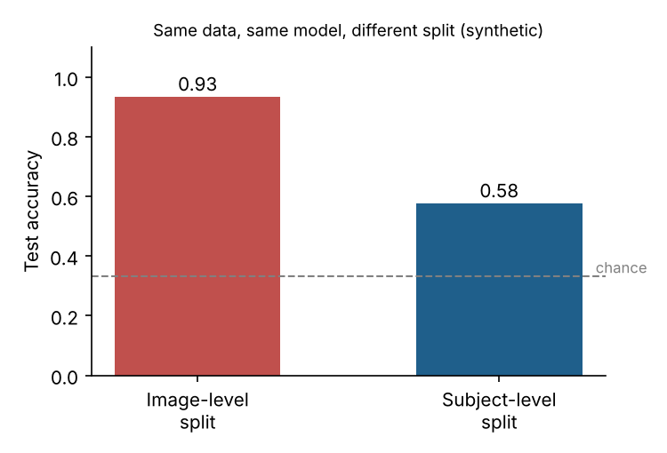

# fMRI Leakage Check: subject-level evaluation for 3D CNNs on neuroimaging data

Companion code for the manuscript **"When Near-Perfect Accuracy Is a Warning Sign: Frame-Level Data Leakage in 3D CNN Classification of the Alzheimer's Disease Spectrum from fMRI Volumes"**, Md. Ariful Islam (2026). The manuscript is under review by the ADNI Data and Publications Committee and will be linked here once it is approved and posted.

## The problem

fMRI gives many volumes (frames) per participant. If those frames are pooled and split **at random by image**, almost every participant ends up in both the training and the test set. A model can then recognise *people* instead of *disease*, and the reported accuracy can approach 100% without meaning anything.

For a participant with *n* frames and a test fraction *p*, the probability that they land on both sides of a random image-level split is

```
P(overlap) = 1 - (1 - p)^n - p^n
```

With *p* = 0.2 this is already 0.9999 at *n* = 40 frames, so in practice overlap is guaranteed.

## What this repository contains

| File | Purpose |
|---|---|
| `src/splits.py` | Subject-level train/test split, stratified subject-grouped K-fold, a `check_leakage()` guard that raises an error if any subject appears on both sides, and the overlap-probability formula |
| `src/model.py` | Keras re-implementation of the 3D CNN described in the paper (64×64×64×1 input, Conv3D 32/64, Dense 256, dropout 0.5; ~45 M parameters) |
| `src/demo_synthetic.py` | A self-contained demonstration on **synthetic** data: same data, same classifier, only the split changes |

## Synthetic demonstration

```bash
pip install -r requirements.txt
python src/demo_synthetic.py
```

Simulated setup: 90 subjects in 3 classes, 60 frames each, a weak class signal and a strong per-subject fingerprint.

```
Image-level split  : accuracy 0.934  (subjects on both sides: 90/90)
Subject-level split: accuracy 0.577  (subjects on both sides: 0)
Chance level       : 0.333
```



The image-level number is inflated by about 36 points purely by the split.

## Using the split utilities on your own data

```python
from splits import subject_level_split, subject_level_kfold, check_leakage

# subject_ids: one ID per image/volume (e.g. ADNI RID or PTID)
train_idx, test_idx = subject_level_split(subject_ids, test_size=0.2)

for train_idx, test_idx in subject_level_kfold(labels, subject_ids, n_splits=5):
    ...  # train and evaluate; check_leakage() has already been run for each fold
```

Recommended protocol (from the paper): split by subject *before* any slicing or augmentation, keep a validation split separate from the test split for early stopping, report subject-level metrics, and use cross-validation with confidence intervals.

## Notes

- **No ADNI data, derived data or results are included.** ADNI data are available only to approved users through the [ADNI/LONI IDA](https://ida.loni.usc.edu/).
- The original training code from the experiment described in the manuscript was not preserved. `model.py` and `splits.py` are a clean re-implementation written from the paper's description, so they are not the exact code that produced the manuscript's figures.
- The corrected, subject-level re-run on ADNI data is future work.

## License

MIT. Contact: sm.islam.ariful@gmail.com
